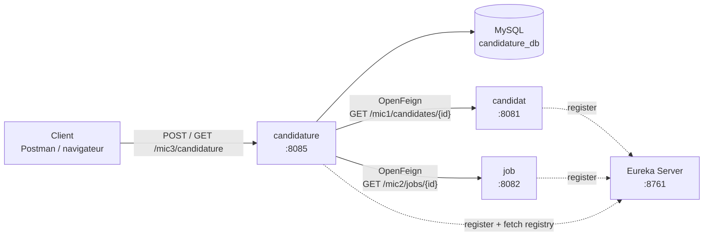
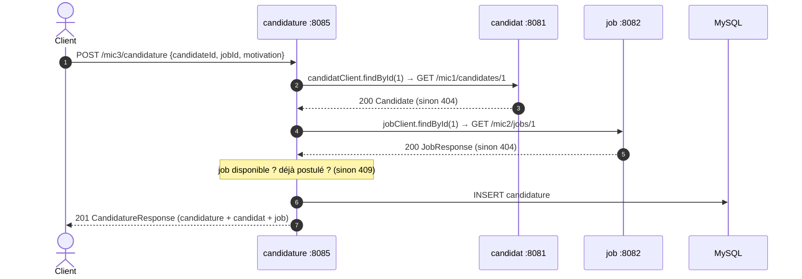

# Microservice candidature

🎓 **Module : Applications Web Distribuées (AWD)**  
📅 **Année universitaire : 2026–2027**  
🧑‍💻 **Workshop 3 – Communication synchrone avec OpenFeign**

---

## 🎯 Rôle du microservice

Le microservice **candidature** permet à un candidat de **postuler à une offre d’emploi (job)**.

Une candidature relie un **candidat** et un **job**, mais ces deux objets n’appartiennent pas à ce microservice :

- les candidats sont gérés par le microservice **candidat** (`CANDIDAT`, port 8081) ;
- les jobs sont gérés par le microservice **job** (`JOB`, port 8082).

👉 candidature stocke donc seulement **`candidateId`** et **`jobId`** dans sa propre base **MySQL**, et récupère le candidat et le job **par HTTP grâce à OpenFeign**, en les retrouvant **par leur nom dans Eureka** (aucune URL ni aucun port écrit en dur).

Après l’ajout d’une candidature, le service renvoie une **`CandidatureResponse`** qui regroupe :
**la candidature + le candidat + le job**.

---

## 🧩 Architecture



💡 **Eureka est un annuaire, pas un proxy** : candidature demande à Eureka où se trouvent `CANDIDAT` et `JOB`, puis Feign appelle ces services **directement**.

### Que se passe-t-il lors de l’ajout d’une candidature ?



---

## 🛠️ Technologies

| Élément | Version / valeur |
|---|---|
| Java | 17 |
| Spring Boot | 3.2.5 |
| Spring Cloud | 2023.0.4 (compatible Spring Boot 3.2.x) |
| Base de données | MySQL 8 – base `candidature_db` |
| Découverte | Eureka Client |
| Communication | Spring Cloud OpenFeign |

---

## 🗂️ Structure du projet

```
src/main/java/esprit/canditature
├── CanditatureApplication.java     @EnableDiscoveryClient + @EnableFeignClients
├── CandidatureRestApi.java         contrôleur REST + gestion des erreurs Feign
├── entity/
│   └── Candidature.java            id, candidateId, jobId, motivation, applicationDate
├── repository/
│   └── CandidatureRepository.java  JpaRepository + existsByCandidateIdAndJobId
├── service/
│   └── CandidatureService.java     règles métier + appels Feign
├── feignClient/
│   ├── CandidatClient.java         @FeignClient(name = "CANDIDAT") → GET /mic1/candidates/{id}
│   └── JobClient.java              @FeignClient(name = "JOB")      → GET /mic2/jobs/{id}
└── dto/
    ├── Candidate.java, Address.java             JSON reçu de CANDIDAT
    ├── JobResponse.java, CategoryResponse.java  JSON reçu de JOB
    └── CandidatureResponse.java                 réponse complète renvoyée au client
```

La réponse complète :

```java
public record CandidatureResponse(Long id, String motivation, LocalDate applicationDate,
                                  Candidate candidate, JobResponse job) {}
```

---

## ⚙️ Configuration (`application.properties`)

```properties
spring.application.name=canditature
server.port=8085

eureka.client.service-url.defaultZone=http://localhost:8761/eureka

spring.datasource.url=jdbc:mysql://localhost:3306/candidature_db?createDatabaseIfNotExist=true&useSSL=false&allowPublicKeyRetrieval=true&serverTimezone=UTC
spring.datasource.username=root
spring.datasource.password=
spring.jpa.hibernate.ddl-auto=update
```

- La base **`candidature_db`** est créée automatiquement (`createDatabaseIfNotExist=true`).
- La table **`candidature`** est créée par Hibernate (`ddl-auto=update`).
- Identifiants MySQL différents ? Modifier `spring.datasource.username` / `password`.

---

## ▶️ Ordre de démarrage

1. **MySQL** (port 3306)
2. **Eureka Server** – http://localhost:8761
3. **candidat** (8081) et **job** (8082)
4. **candidature** (8085) – `mvn spring-boot:run`

⏳ Attendre que **CANDIDAT**, **JOB** et **CANDITATURE** apparaissent dans le dashboard Eureka (jusqu’à 30 s) avant de tester.

---

## 📚 Endpoints

| Méthode | URL | Description |
|---|---|---|
| GET | `/mic3/candidature/hello` | Vérifier que le service répond |
| GET | `/mic3/candidature/candidat/{id}` | Démo Feign : lire un candidat dans CANDIDAT |
| GET | `/mic3/candidature/job/{id}` | Démo Feign : lire un job dans JOB |
| **POST** | `/mic3/candidature` | **Ajouter une candidature** → candidature + candidat + job |
| **GET** | `/mic3/candidature/{id}` | **Une candidature** → candidature + candidat + job |
| GET | `/mic3/candidature` | Toutes les candidatures (complètes) |
| DELETE | `/mic3/candidature/{id}` | Supprimer une candidature |

---

## 🧪 Tester les requêtes

Les exemples utilisent **curl**. Avec **Postman** : même URL, même méthode, et pour les POST
onglet *Body* → *raw* → *JSON*.

### 0. Le service répond

```bash
curl http://localhost:8085/mic3/candidature/hello
```
```
Hello Im microservice 3!
```

### 1. Démo OpenFeign : lire un candidat et un job

```bash
curl http://localhost:8085/mic3/candidature/candidat/1
curl http://localhost:8085/mic3/candidature/job/1
```

Réponse attendue (candidat) :
```json
{"id":1,"firstname":"Badia","lastname":"Abouhdid","email":"badia@example.com",
 "address":{"id":1,"street":"Avenue Habib Bourguiba","houseNumber":"12B","zipCode":"1001","candidateId":1}}
```

🔎 Dans la console de candidature, Feign affiche l’appel :
```
---> GET http://CANDIDAT/mic1/candidates/1 HTTP/1.1
<--- HTTP/1.1 200 (25ms)
```

### 2. Ajouter une candidature ✅ 201

```bash
curl -X POST http://localhost:8085/mic3/candidature \
     -H "Content-Type: application/json" \
     -d '{"candidateId": 1, "jobId": 1, "motivation": "Je souhaite rejoindre une équipe qui travaille avec Spring Cloud."}'
```

Corps JSON (Postman) :
```json
{
  "candidateId": 1,
  "jobId": 1,
  "motivation": "Je souhaite rejoindre une équipe qui travaille avec Spring Cloud."
}
```

> `applicationDate` est facultative : sans elle, la date du jour est utilisée.
> On peut la fournir au format `"applicationDate": "2026-10-12"`.

Réponse attendue – **201 Created** :
```json
{
  "id": 1,
  "motivation": "Je souhaite rejoindre une équipe qui travaille avec Spring Cloud.",
  "applicationDate": "2026-10-12",
  "candidate": {
    "id": 1,
    "firstname": "Badia",
    "lastname": "Abouhdid",
    "email": "badia@example.com",
    "address": { "id": 1, "street": "Avenue Habib Bourguiba", "houseNumber": "12B", "zipCode": "1001", "candidateId": 1 }
  },
  "job": {
    "id": 1,
    "name": "Java Spring Boot Developer",
    "description": "Build microservices with Spring Boot",
    "available": true,
    "date": "2026-09-28",
    "category": { "id": 1, "name": "Software Development", "description": "Backend, frontend and mobile development jobs" }
  }
}
```

🔎 Vérifier dans MySQL :
```sql
SELECT * FROM candidature_db.candidature;
```
Seuls `candidate_id` et `job_id` sont stockés : le reste vient de CANDIDAT et JOB.

### 3. Récupérer une candidature ✅ 200

```bash
curl http://localhost:8085/mic3/candidature/1
```

Même réponse complète que ci-dessus : le candidat et le job sont **relus** à chaque fois dans leurs microservices (2 appels Feign).

### 4. Récupérer toutes les candidatures ✅ 200

```bash
curl http://localhost:8085/mic3/candidature
```

Réponse : un tableau JSON `[ { … }, { … } ]`, chaque élément étant une candidature complète.

### 5. Supprimer une candidature ✅ 204

```bash
curl -X DELETE http://localhost:8085/mic3/candidature/1
```

Réponse : **204 No Content** (pas de corps). Un `GET /mic3/candidature/1` renvoie ensuite **404**.

---

## ❌ Tester les cas d’erreur

| # | Scénario | Requête | Résultat attendu |
|---|---|---|---|
| 1 | Postuler **deux fois** au même job | refaire le POST de l’étape 2 | **409** `Ce candidat a déjà postulé à ce job` |
| 2 | Postuler à un **job fermé** | fermer le job dans JOB, puis POST | **409** `Ce job n'est plus disponible` |
| 3 | **Candidat inexistant** | POST avec `"candidateId": 99` | **404** `Candidat ou job introuvable : …` |
| 4 | **Job inexistant** | POST avec `"jobId": 99` | **404** `Candidat ou job introuvable : …` |
| 5 | **Candidature inexistante** | `GET /mic3/candidature/99` | **404** `Candidature introuvable` |
| 6 | **candidat arrêté** | arrêter candidat, attendre son retrait d’Eureka, puis POST | **503** `Microservice CANDIDAT ou JOB indisponible : …` |

Exemples :

```bash
# 1. doublon -> 409
curl -i -X POST http://localhost:8085/mic3/candidature -H "Content-Type: application/json" \
     -d '{"candidateId": 1, "jobId": 1, "motivation": "Deuxième essai"}'

# 2. job fermé -> 409 (fermer d'abord le job 1 dans le microservice job)
curl -i -X PATCH "http://localhost:8082/mic2/jobs/1/availability?available=false"
curl -i -X POST http://localhost:8085/mic3/candidature -H "Content-Type: application/json" \
     -d '{"candidateId": 1, "jobId": 1, "motivation": "Offre fermée"}'

# 3. candidat inexistant -> 404
curl -i -X POST http://localhost:8085/mic3/candidature -H "Content-Type: application/json" \
     -d '{"candidateId": 99, "jobId": 1, "motivation": "Candidat inconnu"}'
```

> ⚠️ Pour le cas 2, adapter l’URL au contrôleur de **votre** microservice job (`/mic2/jobs/...`).
> Penser à rouvrir le job ensuite avec `available=true`.

Format d’une erreur 409 / 404 levée par le service (`ResponseStatusException`) :
```json
{
  "timestamp": "2026-10-12T22:30:00.000+00:00",
  "status": 409,
  "error": "Conflict",
  "message": "Ce candidat a déjà postulé à ce job",
  "path": "/mic3/candidature"
}
```

> Le champ `message` est visible grâce à `server.error.include-message=always` dans `application.properties`.

---

## 🐞 Problèmes fréquents

| Symptôme | Cause probable | Solution |
|---|---|---|
| `Load balancer does not contain an instance for the service CANDIDAT` | candidat pas encore (ou plus) enregistré dans Eureka | démarrer candidat, attendre 30 s |
| `Communications link failure` au démarrage | MySQL n’est pas lancé | démarrer MySQL |
| Champs `firstname` / `lastname` à `null` | noms des champs du DTO ≠ clés du JSON reçu | aligner `Candidate` sur le JSON de CANDIDAT |
| `no suitable HttpMessageConverter found` | Spring Boot 4 + OpenFeign 5.0 | rester sur Spring Boot 3.2.5 / Spring Cloud 2023.0.4 |
| 404 sur un appel Feign alors que l’id existe | chemin du `@GetMapping` ≠ chemin du contrôleur distant | vérifier `/mic1/candidates/{id}` et `/mic2/jobs/{id}` |

---

## ✅ Tests automatiques

```bash
mvn test
```

Les tests utilisent une base **H2 en mémoire** (`src/test/resources/application.properties`) et désactivent Eureka : MySQL, Eureka, candidat et job n’ont pas besoin d’être démarrés.

---

## 🏫 Cadre pédagogique

### Enseignante : [Badia Bouhdid](https://www.linkedin.com/in/badiabouhdid)

Projet développé dans le cadre du module **Applications Web Distribuées**,
à l’**École d’Ingénieurs ESPRIT**.
